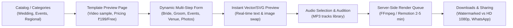

# Wedding Invitation Video Platform: Technical Blueprint & Implementation Plan

> [!NOTE]
> Reverse-engineered from live deep inspection of **InviteCrafter.com** (frontend forms, SVG templating, audio pipelines, merge architecture, and user workflows).

---

## 1. How InviteCrafter.com Works (Reverse-Engineered Findings)

InviteCrafter is **not** a freeform canvas/timeline video editor (like Canva or Premiere). Instead, it is an **algorithmic template-driven dynamic video rendering system**:

### Key Technical Mechanisms Discovered:
1. **Slide/Scene Decomposition**:
   - Each video template is split into 3–5 logical scenes:
     - **Slide 1 (Bride)**: Bride name, parent names, optional circular photo upload.
     - **Slide 2 (Groom)**: Groom name, parent names, optional circular photo upload.
     - **Slide 3 (Event Timeline)**: Haldi, Mehendi, Sangeet, Wedding Ceremony, Reception with respective dates, times, and venue addresses.
     - **Slide 4 (RSVP & Host Details)**: Best compliments, contact numbers, family signatures.
2. **Client-Side Real-Time Preview**:
   - Vector SVGs with standardized variable codes (e.g. `ICFRM-A1`, `ICFRM-B1`, `ICFRM-C1`..`CB`).
   - When the user clicks **Preview**, client-side JS fetches the slide SVG, performs string replacement with user form values, and injects the customized SVG into a modal instantly without server rendering delay.
3. **Image Upload & Crop Pipeline**:
   - Form inputs with `data-shape="circle"`, `data-width="600"`, `data-height="600"`.
   - Client-side Cropper.js modal generates a high-res base64 data URI submitted alongside the form.
4. **Server Video Rendering Engine ("Merge")**:
   - Form posts to `/jsonDecode/...` with text placeholders, base64 cropped images, and selected background music.
   - Background worker processes template composition (visual layers + SVG overlays + audio track) into an MP4 file.
5. **Business & Monetization Logic**:
   - **Free Tier**: Low resolution (480p/720p) with watermark branding.
   - **HD Tier**: 1080p Full HD without watermark for a flat fee (e.g., ₹199 / template).
   - **Auth Gate**: Phone OTP or Google OAuth required prior to submitting the render queue.
   - **Dashboard (`/my_downloads`)**: Displays queued, processing, and ready-to-download videos with direct WhatsApp share (`wa.me/?text=...`).

---

## 2. Recommended Modern Tech Stack

Instead of InviteCrafter's legacy PHP/jQuery stack, build a high-performance modern stack:

| Component | Modern Technology Recommendation | Purpose |
| :--- | :--- | :--- |
| **Frontend Framework** | **Next.js 14+ (App Router, React, TypeScript)** | High SEO performance for template catalog + modern UI state |
| **Styling & UI Components** | **Tailwind CSS + Shadcn UI + Lucide Icons** | Clean, responsive, mobile-first design for wedding customers |
| **Video Engine** | **Remotion (`@remotion/player` & Remotion Lambda/CLI)** | React-based programmatic video generation. Unbeatable for live in-browser preview and serverless cloud rendering |
| **Image Cropping** | **`react-easy-crop` / Cropper.js** | Aspect-ratio & circular mask cropping |
| **Audio Preview** | **WaveSurfer.js or HTML5 Web Audio API** | Audio track preview with waveform and duration sync |
| **Backend API & Queue** | **Node.js / Express / Fastify + BullMQ + Redis** | Render queue job management, progress tracking, and webhooks |
| **Database & ORM** | **PostgreSQL + Prisma ORM** (or Supabase) | Users, templates, order transactions, video jobs |
| **Cloud Storage** | **Cloudflare R2 / AWS S3** | Video assets, user uploads, rendered MP4 exports |
| **Authentication** | **NextAuth / Supabase Auth (Phone OTP + Google)** | Frictionless login |
| **Payment Gateway** | **Razorpay / Cashfree (India) / Stripe (Global)** | Pay-per-download & watermark removal |

---

## 3. End-to-End Feature Roadmap

### Phase 1: Core Template Engine & Dynamic Form (MVP)
- [ ] **Template Schema Definition**: JSON schema specifying scenes, duration, text fields (max length, default text), image slots (crop ratio, circular vs rectangular), and default audio track.
- [ ] **Dynamic Multi-Step Form**:
  - Step 1: Couple details & Parents
  - Step 2: Functions / Ceremonies (Haldi, Mehendi, Sangeet, Wedding, Reception)
  - Step 3: Photos (Couple / Bride / Groom) with interactive cropper
  - Step 4: Music selection (Default track + custom upload or curated library)
- [ ] **Real-time Live Preview**:
  - Embed `@remotion/player` so the user can preview the animated video with their live text and photos playing directly in the browser!

### Phase 2: Server-Side Video Rendering Pipeline
- [ ] **Queue Worker**: BullMQ job queue receiving render requests (`templateId`, `customData`, `audioUrl`, `isPaid`).
- [ ] **Remotion Lambda / Headless Chrome Renderer**:
  - Renders 1080p 30/60fps MP4.
  - Injects dynamic watermark if `isPaid === false`.
  - Normalizes and mixes audio track with fade-in / fade-out.
- [ ] **Progress Updates**: Server-Sent Events (SSE) or WebSocket notifying user when video reaches 25%, 50%, 75%, 100%.

### Phase 3: Auth, Payments & User Dashboard
- [ ] **Authentication**: Google OAuth and SMS/WhatsApp OTP login.
- [ ] **Payment Integration**: Razorpay checkout modal triggered when clicking "Download HD (No Watermark)".
- [ ] **User Dashboard ("My Invitations")**:
  - List of created video invites.
  - "Download MP4" button.
  - "One-Click WhatsApp Share" generating pre-filled invite messages with video/link.
  - "Edit & Re-render" feature allowing corrections within 24–48 hours.

### Phase 4: Regional Localization & Admin CMS
- [ ] **Multilingual Support**: Hindi, Marathi, Gujarati, Punjabi, Telugu, Tamil, and English font sets (Google Fonts: Noto Sans, Rozha One, Poppins).
- [ ] **Admin Dashboard**:
  - Template manager (upload background clips, define placeholder coordinates, attach soundtrack).
  - Order analytics & user management.
